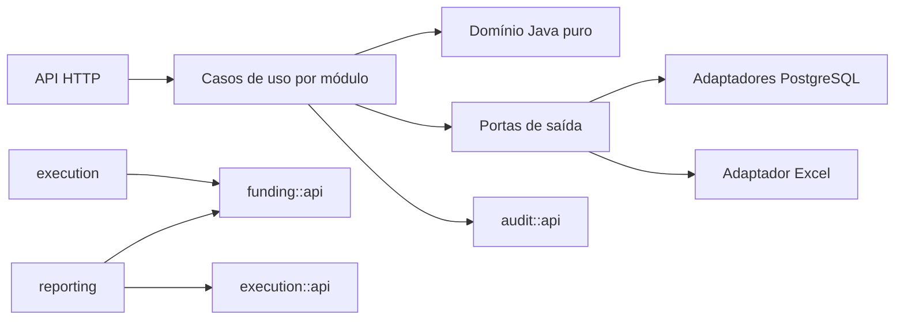

# Arquitetura Spring Boot — decisão e pesquisa

Pesquisa em 16/10/2026, priorizando documentação oficial e relatos das próprias equipes de engenharia. As fontes mostram alternativas e experiências; não foi encontrada uma medição que permita afirmar uma participação de mercado para cada arquitetura. A escolha é orientada pelas necessidades deste sistema.

## Dois níveis da decisão

Implantação: monólito modular. Organização interna: módulos por capacidade de negócio, com domínio independente e portas/adaptadores para persistência, HTTP, autenticação e Excel. São dimensões complementares da arquitetura.

| Alternativa | Aplicação e custo | Decisão neste projeto |
|---|---|---|
| Camadas globais controller/service/repository | Familiar e simples; funcionalidades tendem a atravessar pastas e depender de muitos serviços | Separar camadas dentro de cada módulo, mantendo a funcionalidade localizada |
| Monólito modular | Um processo de implantação com limites internos explícitos; transações locais entre capacidades | Escolhido: preserva atomicidade financeira e permite verificar as dependências |
| Portas e adaptadores / hexagonal | Isola políticas de negócio de HTTP, SQL e arquivos; adiciona contratos e mapeamentos | Escolhido nos limites reais: persistência, consultas entre módulos, autenticação e exportação |
| Microsserviços | Permitem implantação independente; exigem operação distribuída, contratos remotos e tratamento de consistência | Não há requisito de equipes ou implantação independente que justifique esse custo nesta etapa |
| CQRS com projeções e event sourcing | Úteis para reconstruções/projeções próprias, com custo de versionamento e operação | Comandos e consultas separados no código; mesma base transacional. Histórico e estornos são registros imutáveis, sem alegar event sourcing |

## Limites dos módulos

| Módulo | É dono de | Depende de |
|---|---|---|
| foundation | Dinheiro, erros, ator, paginação e execução idempotente | — |
| audit | Histórico imutável e consultas de auditoria | foundation |
| identity | Contas, permissões, senha, sessão e bloqueios de acesso | foundation, audit |
| funding | Parlamentares, emendas e recebimentos com objeto/conta/valor | foundation, audit |
| execution | Empenhos, liquidações, pagamentos e estornos | foundation, funding (interface pública), audit |
| reporting | Consolidação anual, extrato, Excel e registro de exportações | foundation, funding, execution, audit |
| configuration | Composição Spring, segurança HTTP, relógio e bootstrap | interfaces públicas necessárias |

Cada módulo expõe contratos em `api`. O código interno fica em `domain`, `application` e `adapter`. O domínio não importa Spring, JDBC, HTTP, Jackson ou Apache POI. Controllers validam e traduzem requisições; casos de uso coordenam transações e políticas; adaptadores executam I/O.

Os módulos conversam por interfaces Java no mesmo processo. Uma requisição não chama outro módulo por HTTP. Um recebimento é a unidade de bloqueio financeiro; módulos diferentes participam da mesma transação local quando necessário.

## Persistência e integridade

PostgreSQL é o banco de execução e de integração dos testes. Flyway versiona o esquema; dados e credenciais do protótipo Python não são importados automaticamente. Adaptadores JDBC executam consultas parametrizadas e projeções tipadas. Esta escolha evita impor entidades de persistência ao domínio e permite expressar bloqueios/consultas do extrato de forma explícita. JPA foi considerado; permanece uma alternativa de adaptador, não uma dependência das regras financeiras.

Toda escrita financeira ocorre em transação. O recebimento é bloqueado no banco antes da conferência e do lançamento. Idempotência, lançamento e auditoria participam da mesma transação. Um estorno preserva o pagamento original e afeta o ano em que ocorre. Dinheiro usa BigDecimal com duas casas; datas financeiras usam LocalDate; instantes de auditoria usam Instant. O saldo anterior não se transforma em nova receita.

Relatórios combinam interfaces públicas dos módulos e usam uma fotografia transacional consistente. Um módulo não consulta diretamente as tabelas de outro módulo. Chaves estrangeiras entre recebimentos e execução protegem os vínculos no banco.

Consultas que combinam despesas, liquidações e pagamentos usam REPEATABLE READ para apresentar uma única fotografia. Escritas financeiras usam READ COMMITTED e bloqueiam o recebimento antes da conferência, enxergando os lançamentos confirmados enquanto aguardavam o bloqueio. O limite de cada lançamento não limita a soma consolidada de vários recebimentos.

## Verificação executável

- Spring Modulith verifica ciclos, dependências permitidas e acesso indevido a implementações internas.
- ArchUnit verifica domínio independente, controllers sem acesso a persistência e casos de uso sem dependência de adaptadores.
- Testes unitários exercitam regras de dinheiro e linha do tempo sem Spring/banco.
- Testes de integração usam PostgreSQL real via Testcontainers, com Flyway, segurança, API, concorrência, idempotência, auditoria e Excel.
- O build deve falhar quando uma regra arquitetural é violada; não serão adicionadas exclusões para disfarçar dependências incorretas.

## Referências e interpretação

- [Spring Modulith — verificação](https://docs.spring.io/spring-modulith/reference/verification.html): fornece a verificação estrutural que será executada no build.
- [AWS — portas e adaptadores](https://docs.aws.amazon.com/en_en/prescriptive-guidance/latest/cloud-design-patterns/hexagonal-architecture.html): fundamenta o isolamento do domínio e explicita o custo adicional dos adaptadores.
- [Shopify — decomposição do monólito](https://shopify.engineering/deconstructing-monolith-designing-software-maximizes-developer-productivity): experiência de modularização orientada à manutenção; não é evidência de predominância de mercado.
- [Spring — gerações compatíveis](https://spring.io/projects/generations/) e [requisitos do Spring Boot](https://docs.spring.io/spring-boot/system-requirements.html): orientam a seleção de versões compatíveis.

A combinação escolhida é uma decisão para este domínio financeiro e para o escopo aprovado. Os padrões pesquisados não garantem qualidade por si: os limites são materializados no código, no esquema e nos testes.
